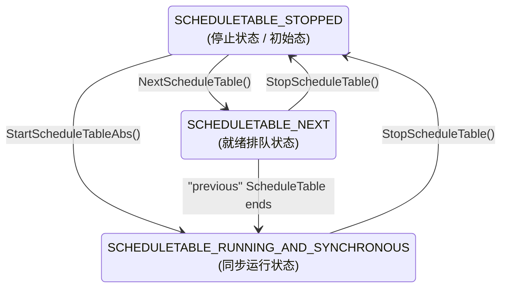
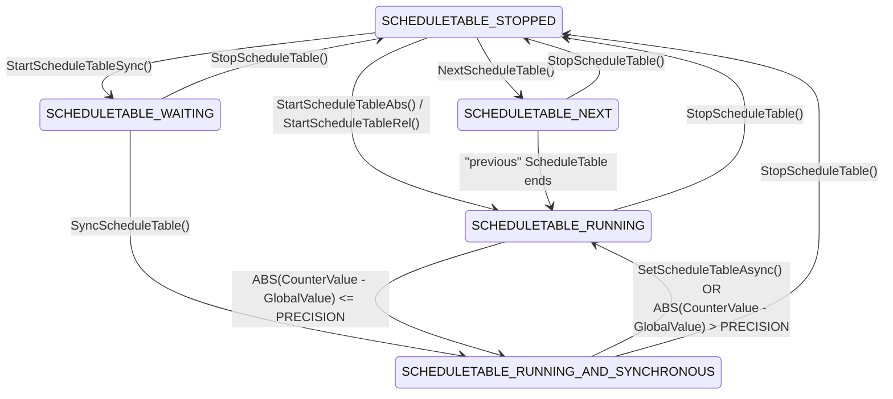

## 概述
### 1. AUTOSAR OS 功能属性：
- **静态配置与裁剪(Statically configured and scaled)** 
- 系统运行所需的所有对象(任务、中断、堆栈空间等)必须在编译前全部静态定义且分配内存，运行时不支持动态创建或者销毁对象。如果不需要的特性可以在生成阶段彻底裁剪掉，以便实现最小的资源占用。
- **实时性能分析友好(Amenable to reasoning of real-time performance)** 
- 面向硬实时系统设计，其上下文切换时间、最坏情况执行时间(Worst-Case Execution Time, WCET)均要求有高度的确定性，以便做调度分析和时序收敛验证。(例如一个10ms的Task确保其实际执行时间不超过10ms)
- **基于优先级的调度策略(Priority-based scheduling policy)**
- 支持基于静态优先级的抢占式/非抢占式(Full-preemptive/Non-preemptive)调度算法。(也就是同事支持优先级打断和独占CPU模式的两种调度方式)
- **运行时保护功能(Protective functions at runtime)**
- 运行时具备安全屏障，在内存保护单元(Memory Protection Unit, MPU)和定时器辅助下，提供内存保护(防止内存越界和非法读写)和时间保护(防止超时任务)。
- **极简资源开销，兼容低端MCU(Hostable on low-end controllers and without external resources)**
- 代码体积与 RAM 占用极小，无需外挂 RAM/Flash 即可在紧凑型、低算力的片上 MCU（如 16 位/32 位单片机）上独立运行。
### 2. 应用领域
- 专用于大部分车载ECU(动力域控制器、车身域控制器等)，==注意通讯和信息娱乐系统除外==。其被假设为使用专有的操作系统，如Windows CE、VxWorks、QNX等。如果要在上述操作系统种运行AUTOSAR组件，则需讲文档中所定义的接口作为操作系统抽象层来提供。AUTOSAR OS 参考OSEK/VDX OS 2.2.3规范为技术基石，做了相关的功能扩展和约束。
## OS功能描述
### 1. CoreOS
#### 1.1 背景
AUTOSAR OS 的核心功能应以 OSEK OS 为基础。具体而言，OSEK OS 提供以下特性，以支持 AUTOSAR 中的相关概念：
- 基于固定优先级的调度机制，仅处理优先级高于任务的中断；
- 针对 OS 服务的不当使用提供一定的防护措施；
- 通过 StartOS() 和 StartupHook() 实现启动接口；
- 通过 ShutdownOS() 和 ShutdownHook() 实现关闭接口；
OSEK OS 除了上述功能之外，还提供了诸多特性。可参考OSEK OS API。

在 AUTOSAR 规范体系中，形如`[SWS_Os_00242]`的方括号标签，是汽车电子软件开发中极为核心的概念——**“规范级需求唯一标识符”（Requirement Unique Identifier）**。无论规范版本如何迭代升级，这个编号终身绑定该条核心规则，永不重复复用。

#### 1.2 Requirements
AUTOSAR OS 应提供一个与OSEK操作系统API向后兼容的API。此外，AUTOSAR OS也根据需求针对OSEK OS的原有API进行了一些限制，对一些未定义行为进行了扩展和补充。
**1.在特定可扩展性等级禁用Alarm Callback**
- 在OSEK中，Alarm到期可以调用一个C语言回调函数；
- 在 AUTOSAR的**SC2、SC3、SC4**等级中，**严禁使用Alarm Callback**。因为回调函数直接运行在中断上下文，极难做内存保护和时间保护；它**仅被允许存在于无保护的 SC1** 中。

> [!NOTE] AutoSAR的可扩展性等级(Scalability Class, SC)
> 用来定义 OS 支持的功能子集，基于老 OSEK 的 Conformance Class 扩展而来。有点类似于Linux内核在编译阶段配置不同选项得到的不同能力规格的系统。
> 
> | 可扩展性等级 (SC) | 内存保护 (Memory) | 时间保护 (Timing) | 核心特性 |
> | :--- | :---: | :---: | :--- |
> | **SC1** | ❌  | ❌  | 标准 OSEK OS+调度表|
> | **SC2** | ❌  | ✅  | SC1 + 时序保护(Timer) |
> | **SC3** | ✅  | ❌  | SC1 + 内存保护(MPU) |
> | **SC4** | ✅  | ✅  | SC1+2+3 |
> 

**2.废除 OSEK COM**
- 传统OSEK OS的内部消息传递接口全部被废除；
- AUTOSAR架构中，跨任务/模块的通信全权由RTE和COM模块负责。

**3.取消OSEK中硬编码的 RES_SCHEDULER**
- OSEK 中无论用不用，系统都默认内置最高优先级的调度锁 `RES_SCHEDULER`；
- AUTOSAR 认为特殊硬编码会破坏统一的时间保护，因此将它视同为普通 Resource，仅在配置需要时才通过工具链生成。

> [!NOTE] 关于OESK中的RES_SCHEDULER
> 在基于优先级上限协议(Priority Ceiling Protocol，PCP)的调度体系中，`RES_SCHEDULER` 是一个**特殊的系统级保留资源**。
> 当一个正在运行的任务调用 类似`GetResource(RES_SCHEDULER)` 时，该任务的运行优先级会瞬间被提升至整个系统中的最高任务优先级。这意味着**在释放该资源前，任何其他任务都无法抢占它**（中断除外）。其本质上相当于一个“任务级临界区锁”，用于保护多任务共享的临界代码段，让任务可以在不关闭硬件中断的前提下安全执行，避免被其他同核任务插队。
> 
> 在OESK OS中，无论工程中是否计划使用它，其均默认、硬编码生成。AUTOSAR要求对执行时间和锁阻塞时间进行静态预算监控。其要求所有锁必须可静态配置，且能被审查。在AUTOSAR OS中，任务要实现类似`RES_SCHEDULER`的功能。必须在静态配置阶段为其配置`OsTaskResourceLock`，并明确设置一个时间上限`OsTaskResourceLockBudget`。若任务持有锁超过该时间，OS会通过`ProtectionHook`将其杀死。以免饿死系统。
> 
> 在实际的AUTOSAR OS中，该资源被设计为按需配置，并通过配置赋予最有任务优先级。一定程度上保持对OESK的兼容。

**4.废除`DeclareTask()`等宏的实际功能**
- 保持向上兼容。但这些宏在AUTOSAR OS的工程中不会起任何作用。

**5.允许系统启动前停机后的中断控制**
- 原有OESK OS仅允许在`startOS()`之后以及`ShutdownOS()`之前调用OS API(比如关中断)。
> [!NOTE] 背景
> 汽车 ECU 的实际运行工况中，芯片复位往往并非单纯由电源重新上电引起的冷复位（Cold Reset），而是高频面临看门狗超时、UDS 诊断请求（如 `$11` 软复位服务）或应用层异常触发的**热复位（非下电复位）**。
> 
> 参考某些 MCU 芯片手册：*在 Application Reset（热复位）期间，部分外设模块的寄存器或外部供电引脚状态并不清零，中断路由器（IR）的悬挂状态位可能受外部活跃信号影响被重新置位。* 故 `EcuM_Init()` 部分需要关闭中断。其参考代码如下：
> 
> ```c
> void EcuM_Init(void)
> {
>     /* 在写敏感寄存器期间关中断 */
>     SuspendAllInterrupts(); 
> 
>     // 初始化OS必要的外设
>     Mcu_Init(&Mcu_Config);
>     Mcu_InitClock(0);
>     while (Mcu_GetPllStatus() != MCU_PLL_LOCKED);
>     Mcu_DistributePllClock();
>     Port_Init(&Port_Config);
>     Wdg_Init(&Wdg_Config);
> 
>     /* 初始化完成，成对恢复 */
>     ResumeAllInterrupts(); 
> 
>     /* 启动 OS */
>     StartOS(OSDEFAULTAPPMODE);
> }
> ```
> 
> **注**：对于传统 OSEK OS 来说，其**禁止在 `StartOS()` 之前调用系统的中断控制 API**，因此只能通过底层 MCU 架构专用的汇编指令（如 ARM 的 `CPSID i` 或 TriCore 的 `DISABLE`）来实现关中断。AUTOSAR OS允许启动前停机后的中断控制后，可提升移植性。

[^1]: Infineon AURIX™ TC2xx / TC3xx Family User's Manual: Reset Control Unit (RCU) / System Control Unit (SCU) - Warm Reset & Pin State Transitions & Interrupt Router (IR)

**6.Alarm 到期支持累加软件计数器**
- 操作系统模块必须提供在报警器（Alarm）到期时，**将“递增一个软件计数器”** 作为备选触发动作的能力。
- 在经典 **OSEK/VDX** 规范中，Alarm 到期后能够触发的动作为如下三种：`ACTIVATETASK`、`SETEVENT`、`ALARMCALLBACK`。AUTOSAR OS 为了打破这一局限，引入了第四种备选动作：`INCREMENTCOUNTER`。这种机制的引入可以更方便地进行软件定时器分频。

**7.支持开机自启动“绝对时间“报警器(Absolute Alarms)**
- 操作系统模块必须允许在操作系统启动阶段，**自动启动预先配置好的绝对报警器。**
- 在涉及全局时钟同步、网关网络时间对齐(如 FlexRay / CAN 全局基准时间)的场景下，某些报警器必须固定在时钟周期的某个绝对刻度上触发。AUTOSAR 允许在工具链配置（ARXML 的 `OsAlarmAutostart`）中直接勾选为绝对启动。

**8.扩展状态下强制防空指针，返回 `E_OS_PARAM_POINTER`**
- AUTOSAR 强制要求所有 API 入口必须进行**防空指针防御性校验**，把致命的系统崩溃收敛成一个可控的返回值 `E_OS_PARAM_POINTER`，提升了基础软件的健壮性。


### 2.Software Free Running Timer
- MCU内部硬件定时器通道数量非常有限。OSEK OS中定时器都是给其内部Alarm(报警器)服务用的。AUTOSAR OS允许软件自由运行定时器。
- 相对于OESK来说这是提升，对于现代操作系统来说这只是个基操。

| 平台 / 操作系统  | 对应的系统时间 API                            | 本质特征                       |
| :--------- | :------------------------------------- | :------------------------- |
| AUTOSAR OS | GetCounterValue()<br>GetElapsedValue() | 单调递增 Tick 时基，专用于耗时测量、超时回绕  |
| Linux      | clock_gettime(CLOCK_MONOTONIC, &ts)    | 从系统启动开始单调递增，不受系统改时间影响      |
| Windows    | QueryPerformanceCounter(&ticks)        | 读取 CPU 高精度硬件时间戳，专用于高精度性能测试 |
| C++ 11     | std::chrono::steady_clock::now()       | 物理时间恒定流逝的稳定单调时钟            |
### 3.Schedule Tables
#### 3.1 Background & Structure
- 传统OESK OS要周期性激活三个任务，其需要配置三个独立的Alarm。引入调度表后，所有的任务激活时机全打包在一条全局时间轴上。调用一个接口就可以实现让整张时间表启动、停止或者切换为另一张表。

- 调度表包含**时间轴、到期点、触发动作、延迟计算、周期循环**五大要素。调度表应当至少包含一个到期点。
- **时间轴：** 囊括了整个调度表的物理周期，其常以Tick的形式存在。Tick对应的物理时间需单独配置(如配置1 Tick = 1ms, 则整表的周期为50ms)。其底层由绑定的时钟计数器(`OsCounter`，如硬件SysTick)按固定节拍驱动。
- **到期点(Expiry Point):** 图中用若干纵向矩形框表示时间轴上的触发时间点。其中第一个和最后一个分别称为首到期点(Initial Expiry Point)和末到期点(Final Expiry Point)。在时间轴始端到首触发点的偏移量称为初始偏移量(InitialOffset)。同样末到期点至调度表的偏移量则称为终延时(FinalDelay)。中间部分的偏移量则称为Offset。这些偏移量代表了各到期点之间的相对节拍差。
- 一个到期点包含至少一个待激活任务集合(可为空)和待设置事件集合(可为空)以及一个以Tick为单位、相对调度表起点的OffSet。
- **触发动作：** 触发动作分为如下两类：激活任务(Task Activations)和设置事件(Event Settings)。同一个到期点中上述两种动作可单独存在也可以同时存在。值得注意的是，同一到期点中，激活任务的优先级总是大于设置事件。任务状态机从`Suspend`/`Waiting`变为`Ready`后，由其优先级来决定执行的先后时序。

> [!NOTE] 关于AUTOSAR OS的两种Task
> 在 AUTOSAR / OSEK 规范体系中，**激活任务(Task Activation)** 与 **设置事件(Event Setting)** 是两种本质截然不同的调度驱动机制，而它们的分水岭正是 **基本任务(Basic Task)** 与 **扩展任务(Extended Task)** 的状态机差异。
> 
> **1. 基本任务 (Basic Task) 的状态机**
> 基本任务没有等待状态。它一旦被激活进入 Ready 态并抢到 CPU，就必须一口气执行到底（除非被更高优先级的任务抢占），直到自行结束。
> ```mermaid
> stateDiagram-v2
>     direction LR
>     
>     [*] --> Suspended : 系统初始化
>     
>     Suspended --> Ready : 激活任务(ActivateTask / Alarm触发)
>     Ready --> Running : 调度器分配CPU(Dispatch)
>     Running --> Ready : 被高优先级任务抢占(Preempted)
>     Running --> Suspended : 任务自行终止(TerminateTask)
> ```
> 
> **2. 扩展任务 (Extended Task) 的状态机**
> 扩展任务比基本任务多出了一个核心的**等待态 (Waiting)**。它允许任务在执行到一半时，主动交出 CPU 并挂起自己，直到某个特定的事件发生。
> ```mermaid
> stateDiagram-v2
>     direction LR
>     
>     [*] --> Suspended : 系统初始化
>     
>     Suspended --> Ready : 激活任务(ActivateTask / Alarm触发)
>     Ready --> Running : 调度器分配CPU(Dispatch)
>     Running --> Ready : 被高优先级任务抢占(Preempted)
>     
>     Running --> Waiting : 主动等待事件(WaitEvent)
>     Waiting --> Ready : 其他实体设置了该事件(SetEvent)
>     
>     Running --> Suspended : 任务自行终止(TerminateTask)
> ```
> 
> **核心差异总结：**
> * **ActivateTask** 是作用于 `Suspended -> Ready` 的状态跃迁，主要用于基本任务的周期性或单次触发。
> * **SetEvent** 是作用于 `Waiting -> Ready` 的状态跃迁，是扩展任务专属的同步与阻塞唤醒机制。正因为有了 Waiting 态，扩展任务才能实现复杂的资源同步。

- **延迟计算：** 节点间距可以不固定。相邻节点的相对时差称为`Delay`。架构师可根据实际负载调整这些OffSet。以实现削峰填谷。
- **周期循环：** 如果是周期循环的调度表。则在末到期点和始到期点之间的Delay为InitialOffset+FinalDelay。
### 3.2 Constraints on Expiry Points
- 一个到期应至少激活一个任务或者至少设置一个事件。
- 在给定的调度表上，每个到期点都应当具有唯一的偏移量。对调度表上各个到期点的迭代推进，是由底层的计数器驱动的。`OsCounterMinCycle`(最小循环周期)和`OsCounterMaxAllowedValue`(最大允许计数值)对偏移量构成约束。
- 同理，相邻到期点之间的延迟也被上述参数约束。
### 3.3 Processing Schedule Table(调度表运行时处理规则)
- 单向不可逆。OS模块必须严格按照偏移量从小到大的顺序，从第一个到期点顺序执行到最后一个到期点。不允许跳过和Reverse。
- 一张调度表只能绑定一个特定的Counter。不能有两个时钟源头同时扯一个表。
- OS要支持多张调度表并发。同一个底层Counter可以同时拉动多张调度表一起跑。
- 严格要求在一个到期点先进行激活任务再进行设置事件。
- 调度表支持两种模式，单次模式(通常跑初始化)和重复模式(日常任务)。配置工具应当提供调度模式`OsScheduleTableRepeating`的配置。
- 注意：即使是单次表的终结时刻也是处理完最后一个到期点后再等待完Final Delay之后才停止(讲状态置为`SCHEDULETABLE_STOPPED` ).
- 对于单次调度表, FinalDelay允许为零, 但循环调度表不允许。其FinalDelay的下限应大于等于底层定时器的`OsCounterMinCycle`最小分辨率。如果InitialOffset和FinalDelay都为0(InitialOffset是允许为0的)。根本不可能连续触发两次中断。

### 3.4 调度表的控制
- 通常调度表的启停由应用程序来控制。==🟡注意这里的应用程序指的是相对OS内核之外。==并非AUTOSAR中的应用层的App。实际应用中，负载启停这些调度表通常由`bswM`、`stbM`、`ecuM`代劳。
- *调度表的启动方式分为两类：*
- 绝对启动：`StartScheduleTableAbs(SchedTableID, Start)`。其机制为指定硬件时钟计数器走到**绝对数字**`Start`时挂载调度表。
- 相对启动：`StartScheduleTableRel(SchedTableID, Offset)`。其机制为以此API调用时刻为基准，向后**延后**`Offset`后再挂载调度表。
- *调度表的停止和重启规则
- 在调度表运行途中任一时刻可以通过`StopScheduleTable(SchedTableID)`来终止这个表。其状态立刻变回`SCHEDULETABLE_STOPPED`.值得注意的是，中途终止的表再次被调度绝不从结束点终止，而是重头再来。
- *模式切换神器，切表API*
- 当车辆从“行车模式”切换为“充电模式”或“产线刷写模式”时调用`NextScheduleTable(CurrentTable,NextTable)`于是就有如下的时序。(1)老表平稳跑完剩余所有到期点,并经过老表的FinalDelay。(2)此时无缝切换到新表，并等待新表的InitialOffset。(3)新表到达第一个到期点。
- *调度表状态查询API*
- `GetScheduleTableStatus` 常用于查询各个调度表的状态，一般来说bswM用其进行状态评估用于模式切换和切表保护。stbM会对调度表进行定期查询，发现异常可能会触发DTC。当然还有一些安全监控的SWC可能会用。
顺便补一个调度表状态机吧：
突然发现下一张就讲，那就不写了。且听下回分解吧。
### 3.5 调度表同步
- 本地Counter模数于调度表周期不一定整除，其会导致调度表的到期点实际执行时的绝对计数值发生变化。且存在不以本地ECU时钟为基准推进的调度表(如通过角度同步，网络全局时间同步)。因此，必须让调度表的推进与某个 **“特定的绝对计数值 / 全局时钟”** 锁定，这就叫做 调度表同步。
- AUTOSAR OS提供了两种调度表同步模式：
- **隐式同步(Implicit Synchronization)**：直接把同步时钟源本身当作驱动调度表的 Counter。即底层硬件负责管理网络时间同步，并仅向操作系统提供一个用于输出或者比较的时间定时器接口。此种同步模式下，调度表的状态机可参考如下：

- **显式同步(Explicit Synchroization)：** 本地驱动调度表的硬件定时器叫 **OS Counter**，而总线上需要对齐的全局基准时间在概念上称为 **Synchronization Counter**。显式同步的本质，就是用软件算法让本地 OS Counter 推进的调度表，去对齐外部的 Synchronization Counter。因此AUTOSAR OS提供了一些特性以保证System Counter与Sync Counter 的同步。具体而言，操作系统通过动态调整调度表里的各个到期点的的触发时机(可调节到期点，Adjustable Expiry Points)，来保证同步。此种模式下，调度表状态机如下：

- 针对上面这个显式同步的状态机，作者将其分为三个阶段来便于描述。
- **阶段一：** 启动起跑有三种选择(从`SCHEDULETABLE_STOPPED`状态出发)。
	- 路线A：调用`StartScheduleTableSynchron()`进入状态`SCHEDULETABLE_WAITING`。其意图为等待拿到总线时间标准时间并严格对齐后再开始跑表。
	- 路线B：调用`StartScheduleTableAbs()/StartScheduleTableRel()`进入状态`SCHEDULETABLE_RUNNING`。其意图为不管总线上是否有全局时间信息，本地任务现在就要跑起来。注意这里的状态没有`_AND_SYNCHRONOUS`后缀，代表没有全局同步过。注意与隐式同步的差别。*Abs和Rel后缀代表绝对时间和相对时间启动。*
	- 路线C：调用`NextScheduleTable()`进入状态`SCHEDULETABLE_NEXT`。其意图为将该表手动安排在某张表执行完成之后开始调用。**注意，下一个表的状态并不会继承上一个表，而是从`SCHEDULETABLE_STOPPED`开始。**
- **阶段二：** 此阶段可分为两个路径
	- ==🟢路线A==：当系统收到总线时间后，调用`SyncScheduleTable()`。从状态`SCHEDULETABLE_WATING`开始跑，状态转移到`SCHEDULETABLE_RUNNING_AND_SYNCHRONOUS`。此时调度表开始执行，且此时的状态带有同步，也就是这个调度表是基于总线时间同步来跑的。
	- 路线B：从`SCHEDULETABLE_RUNNING`对齐。调度表已经在自由游走，但其并无与总线具有同步的时钟关系。外部模块(通常是StbM、BswM、CDD)周期调用`SyncScheduleTable()`来尝试同步。在此期间，OS会做如下步骤：(1)读取本地调度表当前时间走到的表内相对偏移量(localCounterVar)。(2)归一化总线时间：将总线上的绝对时间(GlobalTimeVar)相对调度表周期取模，算出全局时间在表内对应的目标相位点(TargetVar)。(3)顺利成章地，OS可以计算出总线时间和本地时间的偏差(Deviation)。(4)==🟢如果调度表处于**路线A**中的`SCHEDULETABLE_WATING`状态。则OS可以直接强行把调度表时刻指针拨到目标相位点，然后直接宣布这个调度表进入`SCHEDULETABLE_RUNNING_AND_SYNCHRONOUS`状态。==  若此时调度表处于如果当前处于 `SCHEDULETABLE_RUNNING`。则OS会去检查Deviation是否大于容忍的时间误差PRESICION之内。以便决定是否将状态升级到`SCHEDULETABLE_RUNNING_AND_SYNCHRONOUS`。还是尝试继续同步时间。

> [!NOTE] OS具体是如何做调整的呢？
> `SyncScheduleTable()`函数并不直接参与调度表的调频。实际的调整是由OS定时器中断在后台异步推进的。当`SyncScheduleTable()`计算出实际偏差Deviation时，会存入该调度表的OS控制块上下文变量中。直到下一次调度表开始时(注意这个调整绝不会在当前这个调度表的完整周期内生效。)在后续的每一次调度周期中，当 Counter 的硬件定时器中断触发、推进到配置了 **Adjustable Expiry Point（可调节到期点）** 的位置时，OS 调度器会从控制块中取出先前计算的偏差值。OS根据延后还是超前来判定，将这个到期点与下一个到期点之间的等待延迟缩短还是增长。缩短和增长不超过该可调节到期点配置的`OsScheduleTableMaxShorten`和`OsScheduleTableMaxLengthen`。**另外，各个到期点的物理执行顺序不会因为调整而被打乱顺序。**这种微调可能持续几个完整调度表周期，直到时间误差在PRESICION内。调整量的计算方法可参照**“Explicit Synchronization & Adjustment Algorithm”**。

- **阶段三：** 失步和退化
	- 调度表进入 `SCHEDULETABLE_RUNNING_AND_SYNCHRONOUS` 之后，并不是高枕无忧的。图中有两根向下的退化线指回 `SCHEDULETABLE_RUNNING`。当总线时间和本地时间误差超过PRESICION时，OS会立即将其降回`SCHEDULETABLE_RUNNING`，并尝试再次同步。另一种则是主动调用`SetScheduleTableAsync()`以退出与全局时钟的同步。**该 API 只能在 `RUNNING_AND_SYNCHRONOUS` 或 `RUNNING` 状态下调用。** 注意，OS是一个**受控对象**，他不会主动去检查是否同步。都是外部模块调用函数主动检查或者直接Async。OS在这里只有调整可调节到期点的能力。
- **其他：** 这部分主要讲述各种状态如何回退到`SCHEDULETABLE_STOPPED`。如状态机图所示，各种状态均可通过调用`StopScheduleTable()`主动回到`SCHEDULETABLE_STOPPED`。==🟡注意：单次表会自动在FinalDelay结束后回到`SCHEDULETABLE_STOPPED`。此处未在状态机图中直接表现。==

